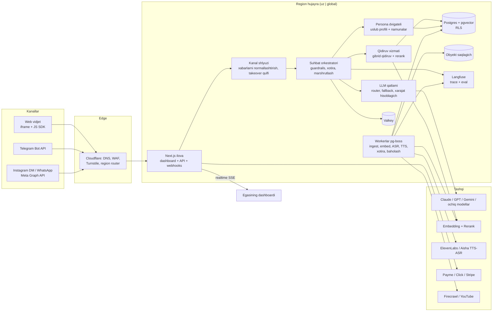

# 04 — Texnik arxitektura

> Holat: taklif (greenfield). Model narxlari va huquqiy talablar ishga tushirishdan oldin qayta tekshirilishi kerak.

## 1. Texnologiyalar steki

| Qatlam | Tanlov | Sabab |
|---|---|---|
| Til / ilova | **TypeScript monorepo (pnpm + Turborepo)**: `apps/web` (Next.js App Router — dashboard, landing, vidjet), `apps/worker` (Node fon vazifalari), `packages/core` (RAG, persona, LLM qatlami), `packages/db` | 1–3 dasturchi uchun frontend, backend va workerlar bitta tilda |
| Ma'lumotlar bazasi | **PostgreSQL 16 + pgvector (HNSW, `halfvec`) + pg_trgm + FTS** | Bitta baza: relyatsion, vektor va kalit so'z qidiruvi. RLS — tenant izolyatsiyasi. ~50 mln chunkgacha alohida vektor DB shart emas |
| ORM | Drizzle | pgvector va RLS bilan qulay, tiplangan SQL |
| Navbat (queue) | **pg-boss** (Postgres asosida) | Yangi infratuzilma yo'q, har bir regionda bir xil ishlaydi |
| Kesh / rate limit | Valkey/Redis | Sessiyalar, limitlar, semantik javob keshi |
| Fayl saqlash | S3-mos (UZ DC'da S3-mos saqlagich; global — Cloudflare R2) | Yuklangan fayllar, audio, eksportlar |
| Autentifikatsiya | **Better Auth** (o'z bazamizda) + Telegram Login + Google OAuth | Ma'lumotlar o'zimizda qoladi |
| LLM | O'z `LLMProvider` interfeysimiz (§5), Vercel AI SDK provayder paketlari ustida | Provayderdan mustaqil, streaming, tool calls |
| Embedding / rerank | Boshlang'ich: boshqariladigan ko'p tilli embeddinglar + Cohere Rerank. Zaxira / suveren variant: **BGE-M3 + bge-reranker-v2-m3** o'z GPU serverimizda | O'zbek tilida recall bo'yicha baholab tanlanadi |
| Ma'lumot yuklash | Firecrawl/Jina Reader (URL), unpdf/LlamaParse (PDF/DOCX, OCR), YouTube subtitr + ASR, Telegram Desktop `result.json` parseri | |
| STT (nutq → matn) | O'zbekcha: ElevenLabs Scribe (~16% WER) yoki fine-tune Whisper; RU/EN: Whisper / gpt-4o-transcribe | Oddiy Whisper o'zbekchada zaif |
| TTS / ovoz klon | ElevenLabs (verifikatsiya oqimi bilan) + Aisha/Yandex bilan A/B test | O'zbek TTS sifati — eng zaif bo'g'in, sinov kerak |
| To'lovlar | **Payme + Click (+ Uzum)** — O'zbekiston; **Stripe** — global (UZ'dan tashqaridagi yuridik shaxs talab qilinadi) | |
| Kuzatuv | Sentry, Langfuse (o'z serverimizda — trace, prompt, baholash), OpenTelemetry | Langfuse baholash ombori sifatida ham ishlaydi |
| Bot himoyasi | Cloudflare Turnstile, IP va foydalanuvchi bo'yicha limitlar | Suiiste'mol va xarajatdan himoya |

### Hosting va O'zbekiston qonunchiligi

**Huquqiy asos ("Shaxsga doir ma'lumotlar to'g'risida"gi ZRU-547 qonuni):**
- 2021-yildan UZ fuqarolari ma'lumotlari O'zbekistondagi serverlarda saqlanishi shart edi.
- **2026-yil 26-mart o'zgartirishi** bu talabni toraytirdi ([Kun.uz](https://kun.uz/en/news/2026/03/27/uzbekistan-amends-personal-data-law-to-facilitate-global-payment-systems)):
  - **biometrik va genetik ma'lumotlar** faqat O'zbekistondagi serverlarda saqlanadi va qayta ishlanadi;
  - boshqa ma'lumotlar adekvat deb tan olingan davlatlarga (2026-yil avgustda 49 ta davlat tasdiqlandi, jumladan AQSh, Buyuk Britaniya, Germaniya, Singapur — [Kun.uz](https://kun.uz/en/news/2026/08/04/uzbekistan-approves-49-countries-for-simplified-personal-data-transfers)) yoki standart shartnomalar asosida o'tkazilishi mumkin;
  - buzilish (breach) haqida 24 soat ichida xabar berish, 72 soatda to'liq hisobot.

**Arxitektura qarori — regionga bog'langan "hujayralar" (cells):**

- **`uz` hujayra** (UZ kreatorlari uchun standart): Toshkentdagi litsenziyalangan DC (Uztelecom/UzCloud yoki boshqa) — Docker, 2–3 VM, Coolify/Kamal orqali; Postgres, Valkey, obyekt saqlagich, Langfuse; pgBackRest zaxira nusxalari. **Ovoz namunalari, ovoz profillari, yuz/video ma'lumotlari (biometrik) faqat shu yerda.**
- **`global` hujayra** (xorijiy tenantlar, v1 dan): Vercel + Neon/Supabase + R2 + Upstash — to'liq boshqariladigan.
- `tenants.region` ustuni + Cloudflare'dagi kichik router trafikni kerakli hujayraga yo'naltiradi. Kod bir xil, faqat konfiguratsiya farq qiladi. **MVP: faqat `uz` hujayra.**
- **LLM chaqiruvlari — chegaradan tashqari qayta ishlash.** Choralar: (1) vidjet va bot start xabarida aniq rozilik matni; (2) promptdan oldin PII niqoblash (telefon, karta, pasport raqamlari yashiriladi, keyin qaytariladi); (3) provayderlarda zero-retention sozlamalari; (4) v2 da "suveren" tarif — ochiq modellar (Qwen/Llama) UZ GPU serverida.
- ⚠️ **Ishga tushirishdan oldin mahalliy yurist xulosasi olinadi** (ayniqsa ovoz klonining biometrik maqomi bo'yicha).

## 2. Komponentlar diagrammasi



## 3. AI yadro

### 3.1 RAG pipeline

**Yuklash (ingest) — worker vazifalari, kontent xeshi bo'yicha idempotent:**
1. **Olish va parse** → strukturali Markdown (sarlavhalar, sahifa raqami, vaqt belgilari). Telegram eksporti post bo'yicha bo'linadi (sana, ko'rishlar, javob zanjirlari saqlanadi). **Egasining izohlardagi javoblari — uslub uchun oltin namuna.**
2. **Til va yozuvni normallashtirish:** o'zbek tili lotin va kirillda yoziladi → `text_original` va `text_norm` (kirill → lotin transliteratsiya, kichik harf, `o' o‘ oʻ` variantlari birlashtiriladi). Har bir chunk tili aniqlanadi (uz/ru/en/aralash).
3. **Chunking:** strukturaga mos, ~400–600 token, 15% ustma-ustlik; ro'yxat va jadvallar bo'linmaydi. Telegram post = 1 chunk (80 tokendan qisqa bo'lsa birlashtiriladi). Transkriptlar ~90 soniyalik oynalar. Har bir chunkga **kontekst sarlavhasi** qo'shiladi ("Hujjat: X › Bo'lim Y") — recall sezilarli oshadi.
4. **Embedding** partiyalarda; har bir chunkda `embedding_model` saqlanadi → to'xtovsiz qayta embedding qilish mumkin.

**So'rov vaqtida:**
1. **So'rovni qayta yozish** (arzon model): suhbat tarixidan olmoshlarni aniqlash, normallashtirilgan so'rov + korpusning asosiy tiliga tarjima (rus tilidagi savol o'zbekcha kontent bo'yicha — tez-tez uchraydi).
2. **Gibrid qidiruv:** pgvector HNSW top-40 + kalit so'z top-40 (`tsvector` `simple` konfiguratsiya — Postgres'da o'zbek stemmeri yo'q — va noaniq moslik uchun `pg_trgm`). **Reciprocal Rank Fusion** bilan birlashtiriladi; har doim `tenant_id, clone_id` bo'yicha filtrlanadi.
3. **Avval "tasdiqlangan javoblar":** egasi tuzatgan savol-javoblar alohida jadvalda; kosinus o'xshashlik > 0.88 bo'lsa — ustuvor kontekst.
4. **Rerank:** top-30 → top-6, ko'p tilli cross-encoder. Eng yuqori ball τ dan past bo'lsa → savol **javobsiz** deb belgilanadi.
5. **Manbali javob:** kontekst `<source id="S3" title=… url=…>` bloklarida, model `[S3]` ko'rinishida iqtibos keltiradi. Post-processing ID'larni tekshiradi va havolaga / "videomda 12:40 da aytganman" ko'rinishiga aylantiradi.

### 3.2 Persona va uslub dvigateli

- **Uslub profilini ajratish** (klon versiyasiga bitta, kuchli model): egasining 30–200 matnidan JSON `StyleProfile` — ohang, rasmiylik (*siz/sen*, *вы/ты*), gap uzunligi, emoji va tinish belgilari odatlari, sevimli iboralar, mavzular, uz↔ru aralashtirish, taqiqlangan mavzular, javobni qanday boshlash/tugatish. Egasi dashboardda slayder va matn sifatida tahrirlaydi.
- **Dinamik few-shot:** `exemplars` jadvali (savol, egasining javobi) — Telegram javoblari, tuzatishlar, onboarding intervyusidan. Har bir navbatda foydalanuvchi tilida eng o'xshash 3–5 namuna olinadi.
- **Kesh uchun qulay prompt tuzilmasi:** `[statik qoidalar + StyleProfile + bio]` (keshlangan prefiks) → `[namunalar]` → `[manbalar]` → `[xotira]` → `[tarix]` → `[xabar]`. Barqaror prefiks kirish narxini ~40–60% kamaytiradi.
- **Onboarding intervyu:** klon egasiga 20 ta savol beradi (ovoz yoki matn) → 1-kundanoq uslub ma'lumoti va FAQ qamrovi.

### 3.3 Guardrails (himoya qoidalari)

- **Grounded rejim (standart):** faqat manbalar, tasdiqlangan javoblar va bio asosida javob. Javob topilmasa — persona uslubida rad etish + taklif: "Bu haqida hali gapirmaganman. Savolingizni [Ism]ga yetkazaymi?" → handoff yoki lid. Egasi "umumiy bilimga ruxsat" tugmasini yoqishi mumkin (ogohlantirish bilan).
- **AI oshkoraligi:** har bir kanalda birinchi xabarda majburiy banner ("Men X ning AI-kloniman"). So'ralganda klon har doim AI ekanini tan oladi — prompt va post-check klassifikator bilan ta'minlanadi. Ovozli javobda birinchi marta ovozli kirish so'zi. (EU AI Act 50-modda talablariga ham mos.)
- **Eskalatsiya triggerlari** (har bir navbatda arzon klassifikator): inson so'rash, sotib olish niyati, shikoyat/jahl, tibbiy/huquqiy/moliyaviy xavfli mavzular, o'z-o'ziga zarar (statik xavfsizlik javobi + ishonch telefoni), ketma-ket 2 marta past ishonch → `handoff` yaratiladi, egasiga Telegram push.
- **Human takeover:** har bir suhbatda `mode = bot | human | paused` (Valkey + Postgres qulfi). Egasining dashboarddagi xabari o'sha kanal orqali yuboriladi. Avtomatik botga qaytish taymeri — ixtiyoriy.
- **Prompt injection'dan himoya:** manbalar "ma'lumot" sifatida o'raladi; manbalardagi ko'rsatmalar e'tiborsiz qoldiriladi; yuklashda injection skaneri; MVP'da yon ta'sirli vositalar (tools) yo'q.
- **Moderatsiya:** kirish va chiqish moderatsiya modelidan o'tadi (provayder endpointi yoki Llama Guard) + egasining taqiqlangan mavzulari.

### 3.4 Har bir foydalanuvchi uchun xotira

- `end_users` (kanal, external_id) bo'yicha; lid telefon/email bersa — profillar birlashtiriladi.
- **Qisqa muddatli:** oxirgi N xabar + ~3k tokendan oshsa umumlashtirish.
- **Uzoq muddatli:** suhbat 30 daqiqa jim qolgandan so'ng worker faktlarni ajratadi (ism, maqsad, xaridlar, til/yozuv, oldingi savollar) → `end_user_memory`. Eng muhim faktlar "Bu odam haqida bilganlaringiz" bloki sifatida qo'shiladi.
- Foydalanuvchi `/forget` (Telegram) yoki tugma (vidjet) bilan xotirasini o'chiradi; egasi xotirani ko'radi va tahrirlaydi.

## 4. Ma'lumotlar modeli (asosiy jadvallar)

Barcha tenant jadvallarida `tenant_id` va RLS siyosati: `tenant_id = current_setting('app.tenant_id')`.

| Guruh | Jadvallar |
|---|---|
| Hisob | **tenants** (region `uz\|global`, plan, spend_cap_usd) · **users** · **memberships** (rol) |
| Klon | **clones** (slug, display_name, languages[], mode_grounded, active_version_id, disclosure_text) · **clone_versions** (style_profile jsonb, system_prompt, model_policy jsonb) — o'zgarmas, baholash va rollback uchun |
| Bilim | **sources** (`pdf\|doc\|url\|youtube\|telegram\|voice\|interview`, status, content_hash) · **documents** · **chunks** (text_original, text_norm, tsv, embedding halfvec(1024), embedding_model, lang, locator {page, ts, url}) |
| Uslub | **exemplars** (savol, javob, origin `telegram\|correction\|interview`, embedding) · **verified_answers** |
| Kanallar | **channels** (`web\|telegram\|instagram\|whatsapp`, config, secret_enc — shifrlangan) |
| Suhbatlar | **end_users** · **end_user_memory** · **conversations** (mode, status, summary) · **messages** (role `user\|assistant\|owner\|system`, citations, model, provider, tokens_in/cached/out, cost_usd, latency_ms, confidence) |
| Sifat | **feedback** (±1, correction_text) · **handoffs** · **eval_sets / eval_cases / eval_runs / eval_results** |
| Biznes | **leads** (fields, stage) · **products** (`subscription\|pack\|one_time`, narx, entitlement) · **entitlements** · **payments** (`payme\|click\|stripe`) · **usage_ledger** (kunlik token va xarajat — billing va marja dashboardi) |
| Ovoz / rozilik | **voice_profiles** · **consents** (`voice_clone\|likeness`, recording_uri, script_hash, ip, signed_at, revoked_at) · **audit_log** |

## 5. Provayder abstraksiyasi va marshrutlash

```ts
type Role = "system" | "user" | "assistant";
interface ChatMessage { role: Role; content: string | ContentPart[]; cacheBreakpoint?: boolean }

interface GenerateRequest {
  messages: ChatMessage[];
  maxTokens: number;
  responseSchema?: JSONSchema;          // strukturali chiqish (klassifikatorlar, ajratish)
  effort?: "low" | "medium" | "high";   // har bir provayderda reasoning/thinking'ga moslanadi
  stream?: boolean;
  metadata: { tenantId: string; cloneId: string; purpose: Purpose; traceId: string };
}
interface GenerateResult {
  text: string; json?: unknown;
  usage: { inputTokens: number; cachedInputTokens: number; outputTokens: number };
  model: string; provider: string; finishReason: "stop" | "length" | "refusal" | "error";
}
interface LLMProvider {
  id: "anthropic" | "openai" | "google" | "openrouter" | "selfhosted";
  models: ModelInfo[];                  // kontekst, narx/MTok, tillar, imkoniyatlar
  generate(req: GenerateRequest & { model: string }): Promise<GenerateResult>;
  stream(req: GenerateRequest & { model: string }): AsyncIterable<StreamEvent>;
}
interface EmbeddingProvider { embed(texts: string[], kind: "query" | "doc"): Promise<Float32Array[]>; model: string; dims: number }
interface Reranker { rerank(q: string, docs: string[], topN: number): Promise<{ index: number; score: number }[]> }

type Purpose = "classify" | "rewrite" | "answer" | "answer_complex" | "memory_extract" | "style_extract" | "judge";
type ModelPolicy = { [p in Purpose]: { primary: string; fallbacks: string[]; maxCostUsd?: number } };
```

**Router mantig'i:**
- Har bir maqsad (purpose) uchun marshrut jadvali `clone_versions.model_policy` da, global standart bilan.
- **Darajalash:** `classify / rewrite / memory_extract` → kichik model (Claude Haiku yoki Gemini Flash darajasi). `answer` → FAQ, salomlashish yoki tasdiqlangan javob topilganda kichik model. `answer_complex` (sotuv, ko'p manbali sintez, pullik obunachi) → o'rta model (Claude Sonnet / GPT / Gemini Pro darajasi). `style_extract` va `judge` → eng kuchli model, faqat oflayn.
- **Fallback:** 429/5xx/timeout (birinchi token 8 s ichida kelmasa) → zanjirdagi keyingi model. Valkey'dagi circuit breaker: oxirgi 60 s da xatolik >20% bo'lgan provayder o'tkazib yuboriladi.
- **Xarajat nazorati:** statik prefiksni prompt caching; takroriy FAQ uchun semantik kesh (klon versiyasi + normallashtirilgan so'rov, o'xshashlik >0.95, 7 kun TTL); tenant bo'yicha kunlik xarajat chegarasi; chat javoblari uchun `maxTokens` ~400; har bir chaqiruv `messages` va `usage_ledger` ga haqiqiy narx bilan yoziladi.
- **Model yangilanishi** faqat baholash darvozasidan (§6) o'tgandan keyin.

## 6. Sifatni baholash (evals)

- **Har bir klon uchun oltin to'plam:** (a) avtomatik — kuchli model korpusdan ~40 savol-javob yaratadi (`must_cite` chunk ID'lari bilan); (b) ~10 ta doiradan tashqari savol (`should_refuse=true`); (c) egasi yozgan savollar; (d) 👎 holatlaridan o'sib boruvchi to'plam. Hammasi uz-lotin, uz-kirill, ru va en tillarida.
- **Metrikalar:** recall@6; **faithfulness** (LLM-hakam javobni da'volarga bo'ladi va har birini manbaga solishtiradi); relevantlik; iqtibos aniqligi; rad etish aniqligi; til/yozuv mosligi; uslub balli (5 ta namuna bilan 1–5); p95 kechikish; javob narxi.
- **Darvozalar:** har bir yangi klon versiyasi, prompt yoki model o'zgarishi to'plamdan o'tadi: faithfulness ≥ 0.9, rad etish aniqligi ≥ 0.9, hech bir metrika 3 balldan ko'p tushmasligi kerak. `packages/core` ga har bir merge'da CI'da 5 ta namunaviy klon bo'yicha "platforma to'plami".
- **Onlayn signallar:** egasi va foydalanuvchining 👍/👎. 👎 → "tuzatish" oynasi: egasi to'g'ri javobni yozadi → (1) `verified_answer`, (2) `exemplar`, (3) eval case. Jonli javoblarning 5% i asinxron faithfulness bilan baholanadi; pasaysa — ogohlantirish.

## 7. Xavfsizlik va maxfiylik

- **Tenant izolyatsiyasi:** har bir jadvalda Postgres RLS (ilova owner bo'lmagan rol bilan ulanadi, har bir tranzaksiyada `app.tenant_id`); har bir vektor so'rovda `tenant_id, clone_id`; obyekt saqlagichda `tenant/{id}/` prefiks va qisqa muddatli imzolangan URL; CI'da tenantlararo sizib chiqish testi.
- **Shifrlash:** hamma joyda TLS; disk shifrlash; kanal tokenlari, to'lov ma'lumotlari va ovoz yozuvlari uchun **envelope encryption** (AES-256-GCM, kalitlar UZ hujayradagi Vault/KMS'da); shifrlangan zaxira nusxalar.
- **Ovoz klonlash roziligi:** faqat hisob egasi o'z ovozini klonlaydi; kamera/mikrofonda tasodifiy rozilik matnini o'qiydi (`consents` ga yoziladi); ElevenLabs ovoz verifikatsiyasi; rozilikni qaytarib olish — 24 soat ichida provayderdan o'chirish; generatsiya qilingan audioga watermark; uchinchi shaxs audiosidan klonlash taqiqlanadi. v2 video-avatar uchun ham xuddi shunday (+ liveness tekshiruvi).
- **Boshqa shaxs nomidan klon yaratishning oldini olish:** klon ommaviy bo'lishidan oldin kreator verifikatsiyasi (Telegram kanal / Instagram / YouTube'ga kod joylash); tasdiqlanmagan taniqli shaxslar uchun nom va yuz blocklisti; har bir vidjetda "shikoyat qilish" tugmasi.
- **Suiiste'mol va xarajatdan himoya:** Turnstile, IP/foydalanuvchi/klon bo'yicha limitlar, maksimal xabar uzunligi, jailbreak va moderatsiya klassifikatorlari, xarajat chegaralari, anomaliya ogohlantirishlari (hajm birdan 10× oshsa).
- **Maxfiylik jarayonlari:** tenant bo'yicha saqlash muddati (standart — xabarlar 24 oydan keyin o'chiriladi); foydalanuvchi so'rovi bo'yicha eksport/o'chirish; LLM'dan oldin PII niqoblash; audit log; provayderlar bilan DPA; UZ shaxsiy ma'lumotlar bazalari reyestrida ro'yxatdan o'tish.

## 8. Birlik iqtisodiyoti (texnik hisob)

**Taxminlar — bitta navbat (foydalanuvchi xabari + javob):** keshlangan statik prefiks 3k token; keshlanmagan namuna, manba, xotira, tarix ~4.5k; chiqish ~300; kichik modelda klassifikator + qayta yozish ~1k kirish / 100 chiqish; bitta rerank chaqiruvi.

| Bitta navbat | Kichik model javobi | O'rta model javobi |
|---|---|---|
| Kirish (kesh + keshsiz) | ≈ $0.0005 | ≈ $0.0096 |
| Chiqish | ≈ $0.00015 | ≈ $0.003 |
| Klassifikator / qayta yozish | ≈ $0.00015 | ≈ $0.00015 |
| Rerank + embedding (boshqariladigan) | ≈ $0.002 | ≈ $0.002 |
| **Jami** | **≈ $0.003** | **≈ $0.015** |

- **80/20 marshrutlash:** ≈ $0.0054 / navbat. O'z serverdagi reranker (≈ $0.0003) va 30% semantik kesh bilan ≈ **$0.003 / navbat** → `finance/model.py` dagi `cost_per_message`.
- **Ovoz:** TTS ~$0.10–0.30 / 1k belgi → 300 belgilik javob $0.03–0.09. Ovoz faqat o'lchanadigan qo'shimcha (daqiqalar paketi).
- **Richaglar:** marshrutlash (eng katta), prompt caching, qisqa chiqish, tarixni umumlashtirish, semantik kesh, arzon reranker, tarif bo'yicha model sifati (o'rta model faqat Pro va pullik obunachilarda), oflayn vazifalar uchun Batch API (−50%). Marjasi 60% dan past tenantlar haftalik tekshiriladi.

> Model narxlari tez o'zgaradi — prod'ga chiqishdan oldin har bir provayderning rasmiy narx sahifasidan yangilang.

## 9. Bosqichma-bosqich qurish rejasi

### MVP (1–8 hafta): bitta kreator web + Telegramda grounded klonni ishga tushiradi va to'lov qiladi
- **1–2 hafta:** monorepo, UZ hujayra infratuzilmasi (VM, Postgres + pgvector, zaxira, Valkey, saqlagich), Better Auth, tenantlar va RLS, CI, Sentry, Langfuse.
- **2–4 hafta:** PDF, DOCX, URL, YouTube transkript, Telegram `result.json` yuklash → chunk → embed; gibrid qidiruv + RRF + rerank; iqtiboslar; uz lotin/kirill normallashtirish.
- **3–5 hafta:** namunalardan persona (StyleProfile + exemplars), onboarding intervyu, guardrails (rad etish, oshkoralik, eskalatsiya), LLM qatlami (Claude asosiy + 1 ta fallback provayder), xarajat logi.
- **4–6 hafta:** kanallar — web vidjet (streaming, Turnstile) va Telegram bot (BotFather tokeni, webhook). Xotira v1.
- **6–7 hafta:** dashboard — inbox, realtime **human takeover**, 👍/👎 va "tuzatish" → tasdiqlangan javoblar, lid yig'ish, asosiy analitika (suhbatlar, javobsiz savollar, top mavzular).
- **7–8 hafta:** Payme/Click obunalari, tarif kvotalari va xarajat chegaralari; versiya chiqarilganda avtomatik oltin to'plam va baholash; rozilik matnlari, maxfiylik siyosati; 5–10 kreator bilan yopiq beta.

### v1 (3–5 oy): monetizatsiya va kanallar
- **Obunachilar uchun pullik kirish:** mahsulotlar, Telegram bot va vidjetda Payme/Click to'lov, xabar/daqiqa huquqlari, kreatorga to'lov (avval kreatorning o'z merchant hisobi orqali); global kreatorlar uchun Stripe.
- Instagram DM + WhatsApp Cloud API (Meta app review, 24 soatlik oyna shablonlari).
- Ovoz: kiruvchi ovozli xabarlar (ASR); **ovoz klonida javob** (rozilik oqimi, o'lchanadigan daqiqalar).
- To'liq marshrutlash jadvali, semantik kesh, regressiya darvozali eval dashboardi, jonli trafikda faithfulness namunalari.
- Analitika v2 (voronka: tashrif → suhbat → lid → to'lov; bilim bo'shliqlari), CRM eksport (Google Sheets, AmoCRM, webhook).
- Xorijiy tenantlar uchun global hujayra.

### v2 (6–9+ oy): farqlanish
- **Video-avatar** javoblar (HeyGen/Tavus darajasidagi API) — rozilik + liveness bilan; Telegram'da asinxron video xabarlar.
- Telegram kanal / YouTube kanaldan bilimni avtomatik sinxronlash.
- Vositalar: uchrashuv band qilish, kursga kirish berish, buyurtma holati — yon ta'sirli harakatlar uchun inson tasdig'i bilan.
- Suveren tarif: ochiq modellar (Qwen/Llama) + BGE-M3 UZ GPU'da — chegaradan tashqari qayta ishlash yo'q.
- Jamoalar, SLA marshrutlash, ommaviy klon marketpleysi, persona versiyalari A/B testlari, biznes uchun white-label.

## 10. Amalga oshirish holati (MVP kodi)

Quyidagilar kodda tayyor va testlar bilan tekshirilgan: §3.1 dagi gibrid qidiruv, RRF, normallashtirish va iqtiboslar; §3.2 dagi barqaror va o'zgaruvchan prompt hamda dinamik few-shot; §3.3 dagi grounded rejim, oshkoralik, eskalatsiya, takeover va PII niqoblash; §4 dagi asosiy jadvallar va RLS; §5 dagi router, fallback va circuit breaker; §6 dagi "tuzatish → tasdiqlangan javob" sikli.

Rejadan ataylab chetga chiqilgan joylar:
- **Drizzle o'rniga sof SQL migratsiyalar va `pg`.** RLS siyosatlari va pgvector operatorlari SQL'da aniqroq ko'rinadi. ORM keyinroq qo'shilishi mumkin.
- **`halfvec` o'rniga `vector(1024)`.** pgvector 0.6 bilan ham ishlashi uchun. pgvector 0.7+ da `halfvec` ga o'tish xotirani ikki barobar tejaydi.
- **Oflayn `HashingEmbedder`.** API kalitisiz ishlab chiqish va CI uchun. Prod'da `TEI_URL` (BGE-M3) ishlatiladi; o'xshashlik chegaralari embedderning o'zida saqlanadi.
- **Eskalatsiya ikki qatlamli.** Birinchisi qoidalar (UZ/RU/EN kalit iboralar): u tezkor yo'l va xavfli mavzu bo'lsa LLM'siz javob beradi. Ikkinchisi kichik modeldagi strukturali klassifikator; u xato bersa, qoidalarga qaytiladi.

## 11. Repo tuzilmasi (reja)

```
ai-clone/
├── apps/
│   ├── web/            # Next.js: landing, dashboard, vidjet, API, webhooklar
│   └── worker/         # pg-boss vazifalari: ingest, embed, ASR/TTS, xotira, eval
├── packages/
│   ├── core/
│   │   ├── src/llm/provider.ts         # LLMProvider, router, fallback, xarajat
│   │   ├── src/rag/retrieve.ts         # gibrid qidiruv, RRF, rerank, uz normallashtirish
│   │   └── src/orchestrator/turn.ts    # guardrails, persona prompt, xotira, eskalatsiya
│   ├── db/src/schema.ts                # Drizzle sxema + RLS siyosatlari
│   └── channels/                       # telegram, widget, instagram, whatsapp adapterlari
├── infra/                              # UZ hujayra: docker-compose, Kamal/Coolify, backup
├── evals/                              # platforma eval to'plamlari
├── docs/                               # shu hujjatlar
└── finance/                            # moliyaviy model
```
