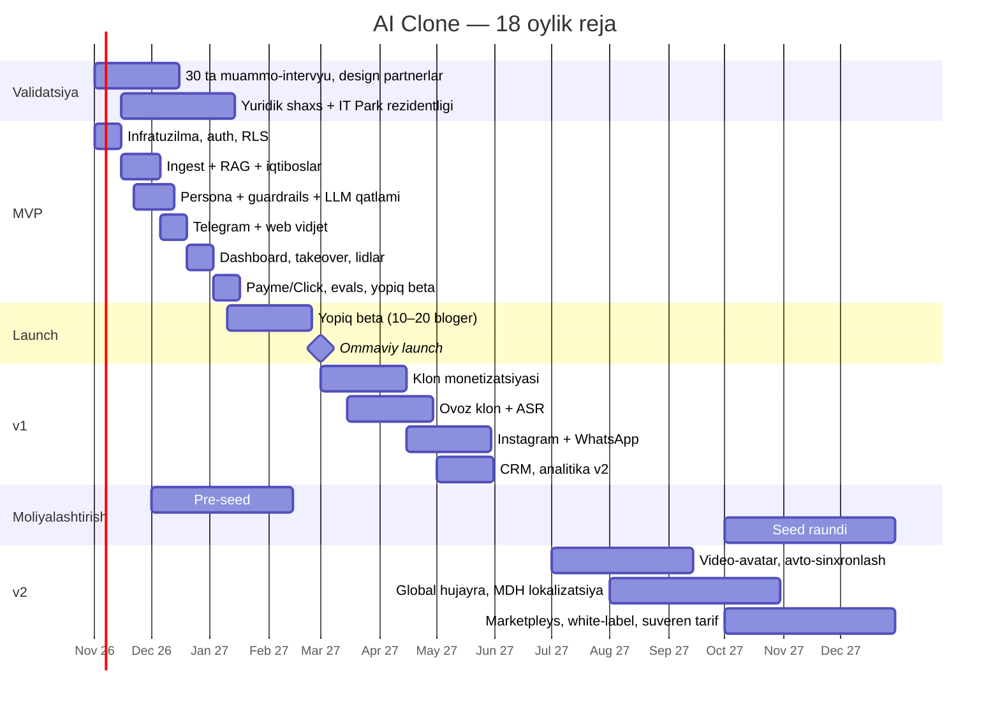

# 08 — Yo'l xaritasi (roadmap) va OKR'lar

## 18 oylik yo'l xaritasi

## Asosiy bosqichlar (milestones)

| # | Bosqich | Sana (taxm.) | Muvaffaqiyat mezoni |
|---|---|---|---|
| M1 | 10 ta design partner imzolandi | 2026-dekabr | 10 ta yozma kelishuv, 5 ta oldindan to'lov |
| M2 | MVP — yopiq beta | 2027-yanvar | 10 ta klon jonli, faithfulness ≥ 0.85 |
| M3 | Product-market fit signallari | 2027-fevral | 40%+ beta foydalanuvchi "mahsulotsiz juda xafa bo'laman" (Sean Ellis testi) |
| M4 | Ommaviy launch | 2027-mart | 1-oyda 1 000 ro'yxat |
| M5 | $5k MRR | 2027-iyun | |
| M6 | Klonlar orqali birinchi $10k GMV | 2027-iyul | |
| M7 | $10k MRR, 300 pullik | 2027-oktyabr | Seed raundiga tayyor |
| M8 | Birinchi xorijiy bozor | 2027-dekabr | Qozog'iston yoki rusiyzabon MDH, 50+ pullik |

## OKR'lar

### 2026-Q4 (validatsiya + MVP)

**O1: Muammo va to'lovga tayyorlikni isbotlash**
- KR1: 30 ta ekspert-bloger bilan muammo-intervyu
- KR2: 10 ta design partner, kamida 5 tasi oldindan to'lagan
- KR3: "Eng ko'p takrorlanadigan savollar" bo'yicha 10 ta kanal tahlili (gipotezani raqam bilan tasdiqlash)

**O2: MVP'ni qurish**
- KR1: Telegram + web vidjet orqali 10 ta klon jonli ishlaydi
- KR2: O'zbek (lotin + kirill), rus tillarida golden setda faithfulness ≥ 0.85
- KR3: p95 javob vaqti < 6 s

### 2027-Q1 (beta + launch)

**O1: Klonlar haqiqiy qiymat yaratsin**
- KR1: Har bir faol klonda haftasiga ≥ 50 foydali suhbat
- KR2: 👍 ulushi ≥ 80%
- KR3: Kamida 3 ta case-study o'lchanadigan natija bilan (sotuv, tejalgan vaqt)

**O2: Ommaviy ishga tushirish**
- KR1: 2 000 ro'yxat
- KR2: 100 pullik mijoz
- KR3: Yangi ro'yxatlarning ≥ 30% i viral sikl yoki affiliate'dan

### 2027-Q2 (monetizatsiya)

**O1: Klon egalariga pul ishlatish**
- KR1: 50 ta klon pullik kirishni yoqadi
- KR2: $10k oylik GMV
- KR3: Ovoz klonidan foydalanuvchi Pro mijozlar ≥ 30%

**O2: Barqaror o'sish**
- KR1: $5k MRR
- KR2: Oylik churn ≤ 6%
- KR3: CAC ≤ $35, LTV/CAC ≥ 5

## Har haftalik ritm

- **Dushanba:** metrikalar sharhi (North Star — haftalik foydali suhbatlar), haftaning 3 ta ustuvor vazifasi
- **Chorshanba:** 2–3 ta mijoz bilan suhbat (asoschilar har hafta mijoz bilan gaplashadi)
- **Juma:** demo (nima chiqdi), eval natijalari, retro
- **Har oy:** investor/maslahatchi yangiliklari xati (investor update)
